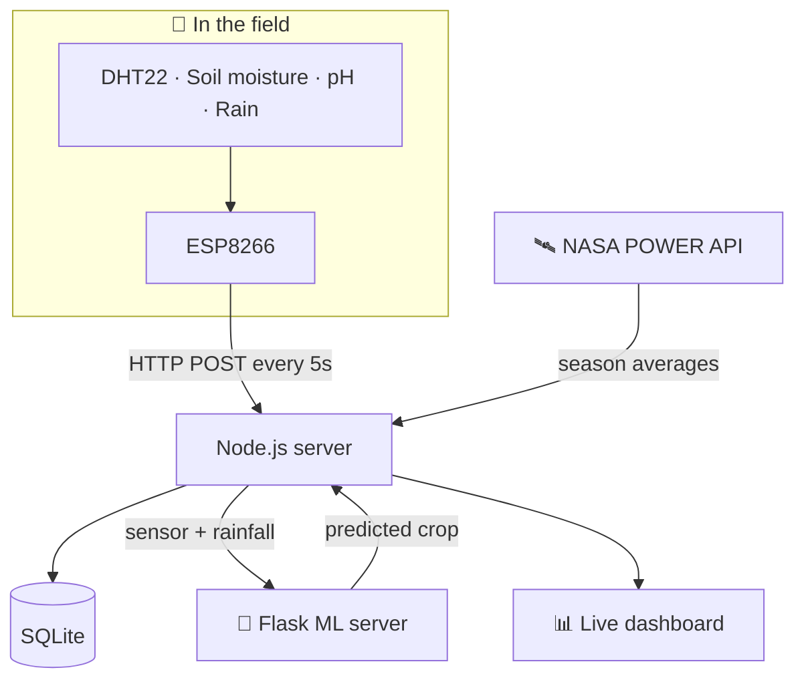

# 🌱 Smart Soil Sense

### Read the soil. Know the season. Get the right crop.

An IoT and machine-learning system that measures soil and weather in the field, streams it to a live dashboard every 5 seconds, and **recommends the best crop to grow**, using live sensor data plus NASA climate data for Bangladesh's farming seasons.

---

## ⚡ The problem → the fix

> Farmers often choose crops by habit, not by what the soil and season actually support. The result is lower yields and wasted inputs.

**Smart Soil Sense** puts sensors in the soil, adds this season's climate averages from NASA, and lets a trained model answer one question: **what should I plant here, now?**

---

## ✨ Features

| | Feature | What it does |
|:-:|---|---|
| 📊 | **Live field dashboard** | Temperature, humidity, soil moisture, soil pH and rain, refreshed every 5 seconds |
| 🌾 | **Crop recommendation** | ML model predicts the best crop from soil, weather and seasonal rainfall |
| 🛰️ | **NASA climate data** | Pulls rainfall, temperature and humidity averages from NASA POWER |
| 🗓️ | **Bangladesh farming seasons** | Data grouped into **Rabi, Kharif-I and Kharif-II**, not calendar months |
| 🕒 | **Reading history** | Every reading stored and filterable by date and time range |
| 🟢 | **Connection status** | Live Connected / Offline indicator with an offline banner |
| 📶 | **Easy Wi-Fi setup** | Device opens its own "Smart Soil Sense" hotspot to connect to any Wi-Fi, no re-flashing |
| 🚀 | **One-command start** | `node server.js` serves the dashboard, starts the ML server, opens the browser |

---

## 🔌 Hardware

| Part | Measures |
|---|---|
| **ESP8266** | Wi-Fi microcontroller that reads the sensors and posts data |
| **DHT22** | 🌡️ Air temperature and 💧 humidity |
| **Soil moisture sensor** | 🌱 Soil moisture (calibrated to %) |
| **pH sensor** | ⚗️ Soil pH |
| **Rain sensor** | 🌧️ Rain detection |
| **CD4051 multiplexer** | Lets three analog sensors share the ESP8266's single analog pin |

---

## 🏗️ How it works

---

## 👨‍💻 My role

- **Hardware & firmware:** wired the sensors through a multiplexer and wrote the ESP8266 firmware, including hotspot-based Wi-Fi setup
- **Backend:** built a zero-dependency Node.js server with SQLite storage, history API and NASA POWER integration
- **Machine learning:** trained the crop-prediction model and served it through a Flask API
- **Dashboard:** designed the live field dashboard with history filters and offline handling

---

**More of my work: [MSSohan](https://github.com/MSSohan)**

